# Nabu walkthrough: any document, read on your own machine

Nabu learns a form once and then reads every later copy of it in seconds, all on your own computer. This page is the team walkthrough deck in text form, with its screenshots. Slides deck: [Nabu: any document, read locally](https://claude.ai/artifact/4KhsrAkc8tDhU9Dhu7jYvc) (shared inside the organisation).

Every document shown is synthetic: the issuer SAMPLE STATE, the holders and every value are made up. Timings were measured on 2026-11-06 and 2026-11-12 (see [What we measured](#what-we-measured)).

- [What Nabu is](#what-nabu-is)
- [How Nabu reads a document](#how-nabu-reads-a-document)
- [What it needs to run](#minimum-requirements)
- [Creating a template with the model's suggestions](#creating-a-template-with-the-models-suggestions)
- [Reusing the template on the next card](#reusing-the-template-on-the-next-card)
- [Creating a template by hand, with no model](#creating-a-template-by-hand-with-no-model)
- [The output: one JSON file per document](#the-output-one-json-file-per-document)
- [What we measured](#what-we-measured)
- [Where this goes next](#where-this-goes-next)
- [Try the beta](#try-the-beta)

## What Nabu is

A document reader that runs entirely on your machine, with a local model doing the reading.

| | |
|---|---|
| **Private by design** | OCR and the model run locally. No document leaves the machine. |
| **Any document type** | You name a new form once. Nabu learns it and recognises it next time. |
| **English out** | Documents in other languages come back in English; terms that don't translate cleanly are highlighted, not guessed. |
| **Plug and play** | A standalone module. Each verified document's JSON can land in a folder another service reads. A direct service API is not built yet. |

Nabu was the Babylonian god of writing and scribes, keeper of the clay tablets.

## How Nabu reads a document

1. **Read the page.** Photo, scan, PDF or office file. OCR runs on this machine.
2. **Recognise the form.** Fixed text and printed labels are matched against saved templates.
3. **Find the fields.** From the template. No template: the local model suggests them, or you draw them.
4. **You review.** Fix names, values and boxes, then press Verify.
5. **JSON out.** Download it, or let another service pick it up. Saving teaches Nabu the template.

A template stores field names, positions and the form's fixed text. **Never the values.** The network is used only to install Nabu, Ollama, the model and OCR language packs.

There are two moments per form:

| | First card of a form | Every card after |
|---|---|---|
| Time (NVIDIA GPU, `qwen3.5:9b`) | about 1 min | 3–8 s |
| Time (CPU only, `qwen3.5:4b`) | 155–190 s | — |
| What happens | The model reads the page and suggests every field. You check them, fix names once and save a template. | Nabu recognises the form, links the template and reads each value from the saved place. You review only what it flags. |

## Minimum requirements

| | |
|---|---|
| System | Windows 10 or 11, 64-bit, Intel or AMD. macOS on Apple silicon or Intel (beta, not yet tested) |
| Memory | 8 GB to run a model. Below that, no model by default (templates and digital files); the smallest, `qwen3.5:0.8b`, can be added |
| GPU | Optional. Only NVIDIA is detected, so a Mac is sized by memory |
| To install the beta | git, Node.js 20+, internet for the first setup. No admin rights, no Python |
| Disk | Nabu 0.4 GB + Ollama (1.6 GB Windows, 0.17 GB macOS) + the model below + 2 GB spare |

| Machine | Model picked | Download |
|---|---|---|
| 8–15 GB memory | `qwen3.5:2b` | 2.7 GB |
| 16–31 GB memory | `qwen3.5:4b` | 3.3 GB |
| 32 GB, or 16 GB + NVIDIA 6 GB | `qwen3.5:9b` | 6.6 GB |
| NVIDIA 16 GB+ | `qwen3.5:27b` | 17.5 GB |

## Creating a template with the model's suggestions

### 1. Drop the photo, press Read document

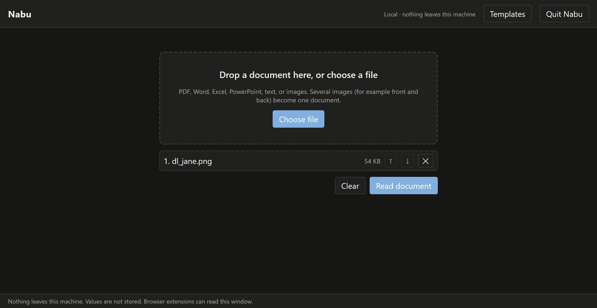

Any photo, scan or PDF. Front and back images become one document. The card here is a phone-style photo of the first (synthetic) holder. This store is empty, so there is no template for this form yet.

### 2. No template yet: the model suggests fields

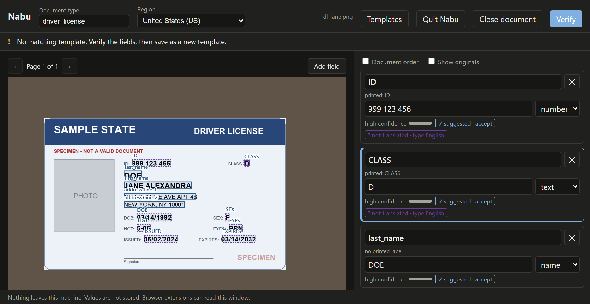

The banner says **No matching template**. The first read took about a minute and suggested 12 fields, each with its box on the photo; all 12 values were right. Fields printed with a label (ID, DOB, EXPIRES) keep that label. Name and address lines have none, so the model names them (`last_name`, `address_line_1`, …). Headings such as SAMPLE STATE are not offered as fields; they are kept as fixed text.

### 3. Rename once, then Verify

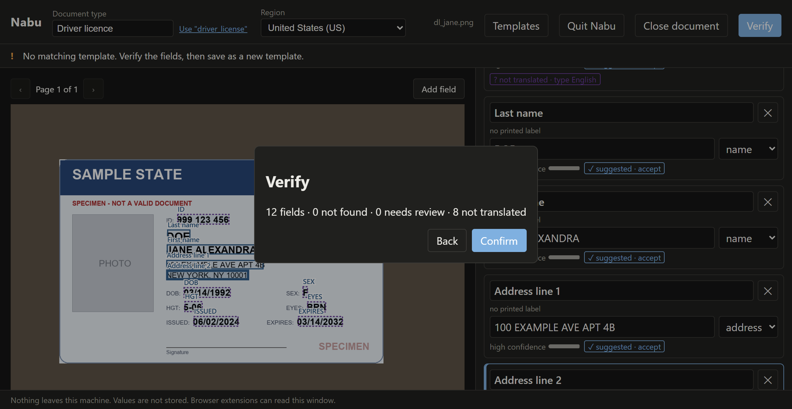

`last_name` became **Last name**, and so on for four fields. Document type is set to Driver licence, region US. Names you type are kept in the template, so this rename happens once per form, not once per card. Verify counts what is left: **0 not found, 0 needs review**. The 8 "not translated" are the printed labels, which are already English. Press Confirm.

### 4. Save as a new template

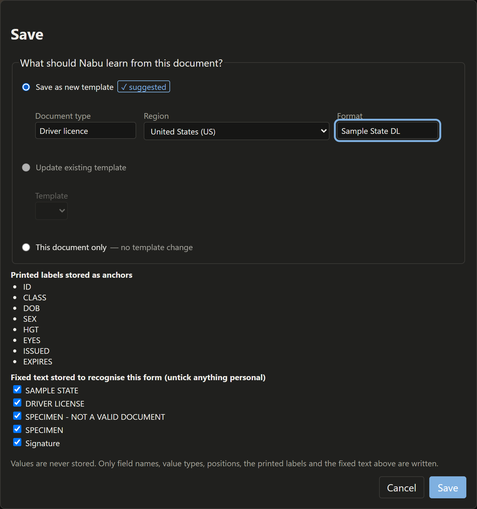

Nabu proposes **Save as new template** because nothing matched. Name the format, here *Sample State DL*. The dialog lists exactly what is written: field names, types, positions, 8 printed labels as anchors and 5 pieces of fixed text. **Never the values.** Untick any fixed text that is personal. Fixed text spread from the top to the bottom of the card lets Nabu measure the zoom on the next photo. After Save, the JSON is ready to download.

## Reusing the template on the next card

### The template in the Templates list

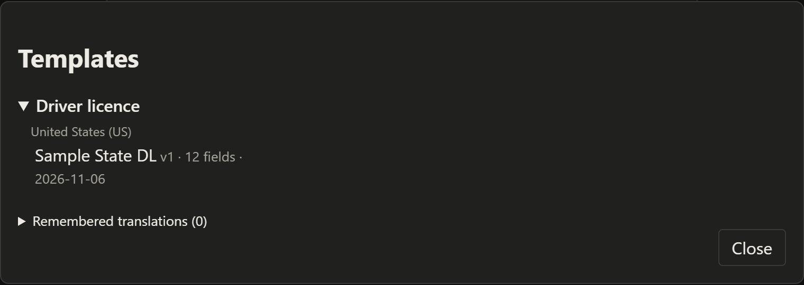

Every saved template appears under the **Templates** button, grouped by document type and region.

### The next card: another holder, photographed 1.25× closer

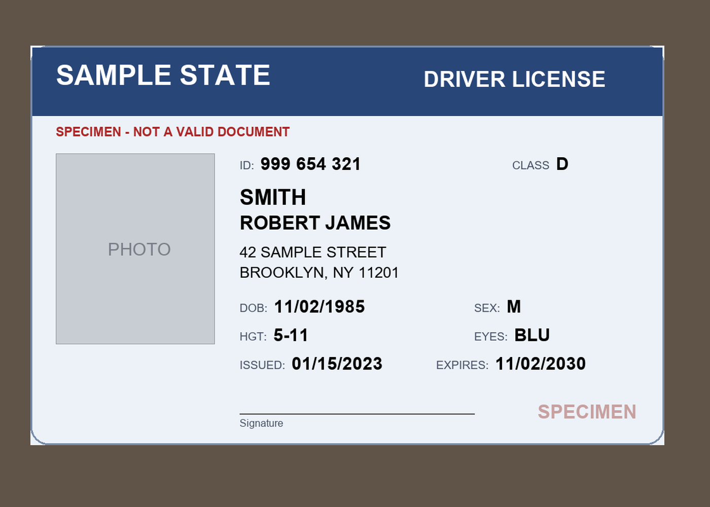

Same form, different values, different framing: the card is 25% bigger in the frame and shifted. This is why a template keeps fixed text spread across the card.

### 5. Nabu links the template in seconds

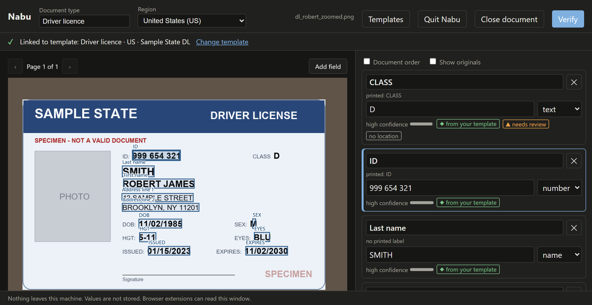

Banner: **Linked to template Driver licence · US · Sample State DL**. No template choice was needed: Nabu found the form by its fixed text and labels. All 12 values were right, read in about 3 s, with your names. CLASS, a single letter, is marked **needs review**: its box was not found on this read, so a second model read filled it. It was right.

### 6. Verify, then take the output

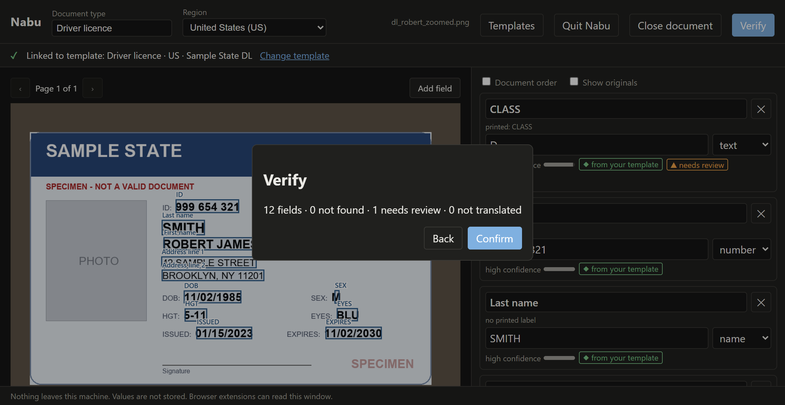

Verify: 12 fields, 1 needs review, 0 not found. Nothing was edited, so there is no save step: Confirm goes straight to the JSON. Nabu keeps no copy of the output.

## Creating a template by hand, with no model

The model will not always get it right, and Nabu also runs with no model at all. Four tools fix anything before you save:

1. **Edit the name or value.** Click the field and type.
2. **Box on the wrong text?** Remove the field and draw it again with Add field. Boxes can't be dragged or resized yet.
3. **Add a missed field.** Draw a new box where the model found nothing, then name it.
4. **Remove a wrong field.** Delete anything that is not a real field, such as a heading.

Names and boxes you fix go into the template, so the next card of the form is read right without fixing it again.

### 1. Add field: drag a box, name it

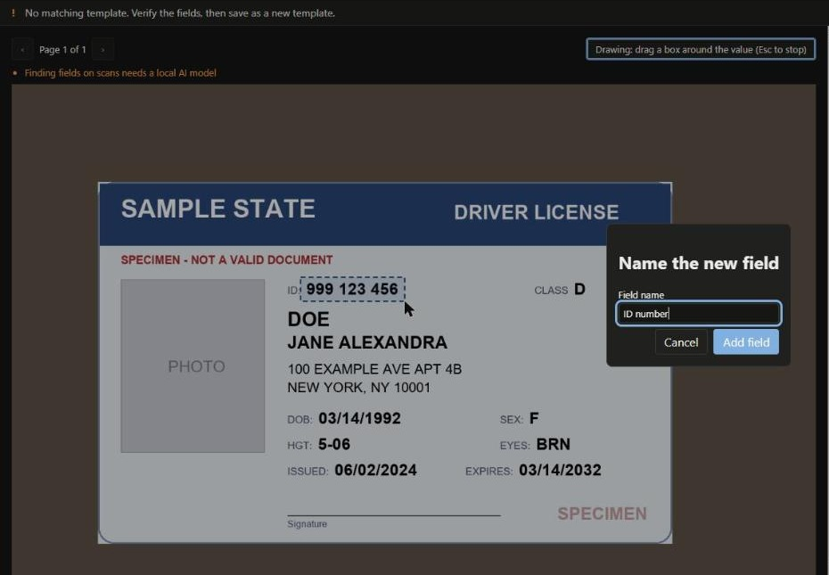

With no model, the first read finds **0 fields**. Press **Add field**, drag a box around a value and type its name, here *ID number*. OCR reads the text inside the box; no model is needed.

### 2. Repeat for each field, then Verify

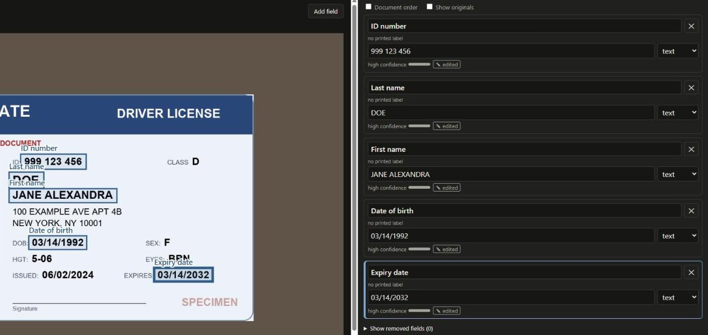

Draw only the fields you need; here five. Set document type and region at the top. Drawn fields start as type *text*: pick **date** for dates so the JSON gets ISO dates. Verify showed **5 fields · 0 not found · 0 needs review**.

### 3. Save the template, untick anything personal

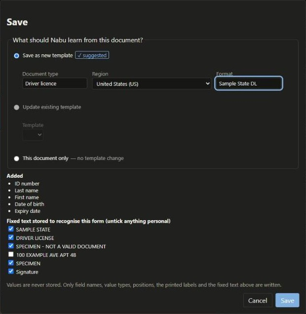

The address was not drawn as a field, so Nabu offered it as fixed text. **Untick it**: it is personal. Kept to recognise the form: SAMPLE STATE, DRIVER LICENSE, SPECIMEN, Signature.

### 4. Next card: fields come from your template

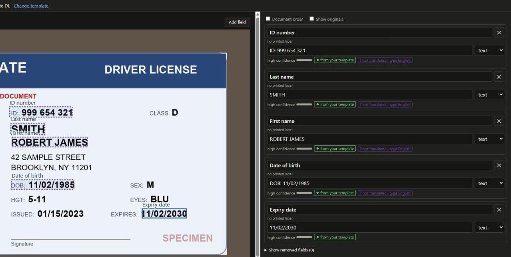

Another holder, photo 1.25× closer, still no model. The card links to *Sample State DL* and all 5 fields land on the right lines. **Check before Verify:** on two fields the printed label next to the value was read into it ("ID: …", "DOB: …"), seen in 2 of 2 runs. Hand-drawn fields store no printed label, so Nabu cannot strip it yet; edit those two values. The fix is open. The purple "not translated" chips appear because no model is installed; they don't change the values.

## The output: one JSON file per document

Real output of the hand-made template run (synthetic card), shortened:

```json
{
  "schema_version": "1.0",
  "document_type": "Driver licence",
  "region": "US",
  "format": "Sample State DL",
  "template_id": "tpl_driver_licence_US_sample-state-dl",
  "template_version": 1,
  "source_file": "dl_jane.png",
  "verified_at": "2026-11-12T06:10:41Z",
  "fields": [
    { "name": "ID number", "value": "999 123 456" },
    { "name": "Last name", "value": "DOE" }
  ],
  "not_found": [],
  "untranslated_terms": []
}
```

- `fields`: your field names, values in English. Fields of type *date* become ISO dates, an amount gets its currency code, and a changed value keeps its original beside it. Names, numbers and IDs are never translated.
- `not_found`, `untranslated_terms`: what still needs a person.
- `template_id` + `template_version`: which template read it.

Download it, or set an export folder (see the README, "Export folder") so another service picks every confirmed document up. Nabu keeps no copy. Schema: [`src/nabu/schemas/output.schema.json`](../src/nabu/schemas/output.schema.json).

## What we measured

| Run | Time | Values right | Flagged for review |
|---|---|---|---|
| First read, no template (3 runs, API) | 55–66 s | 12/12 each | none |
| First read in the window | about 1 min | 12/12 | none |
| Linked, photo 1.25× closer (window) | about 3 s | 12/12 | CLASS |
| Linked, photo 1.25× closer (API) | 8 s | 12/12 | CLASS |
| Linked, photo 0.8× further (API) | 6 s | 12/12 | none |
| First read, CPU only, `qwen3.5:4b` (2 runs) | 155–190 s | 12/12 each | none |
| Hand-made template, no model, linked 1.25× closer (2 runs) | ≤ 8 s | 3/5 clean | ID, DOB kept their label |

Synthetic SAMPLE STATE card. GPU rows: `qwen3.5:9b` on an RTX 4060 Laptop (8 GB), 64 GB memory, 2026-11-06. CPU and no-model rows: 2026-11-12, on a 28-core CPU, so an ordinary laptop will be slower. API runs used Nabu's own review API with the real OCR and model, in a fresh store.

## Where this goes next

Today a person builds every template: the local model suggests fields on the first card, or someone draws them, and a person checks, names and saves the template once per form.

Next, an ML model trained on samples of each document type drafts the template itself, and people review only what it is unsure of. This is a direction, not built yet, and the learning model must also run locally to keep documents on the machine.

## Try the beta

```powershell
# Windows: double-click start-nabu.cmd in the cloned folder, or in PowerShell:
git clone <repo URL> nabu
cd nabu
powershell -ExecutionPolicy Bypass -File start-nabu.ps1
```

```bash
# macOS (beta, not yet tested)
git clone <repo URL> nabu
cd nabu
sh start-nabu.sh
```

The script checks the machine, installs Nabu (or updates it after `git pull`), starts Ollama and gets the model after one yes/no question that shows the sizes, then opens Nabu in your browser. Later, run it again or use the **Nabu** shortcut. Full guide: [README, "Try the beta (team)"](../README.md#try-the-beta-team).

Report problems with the terminal output and `nabu doctor --json`. Never send document images or values.
